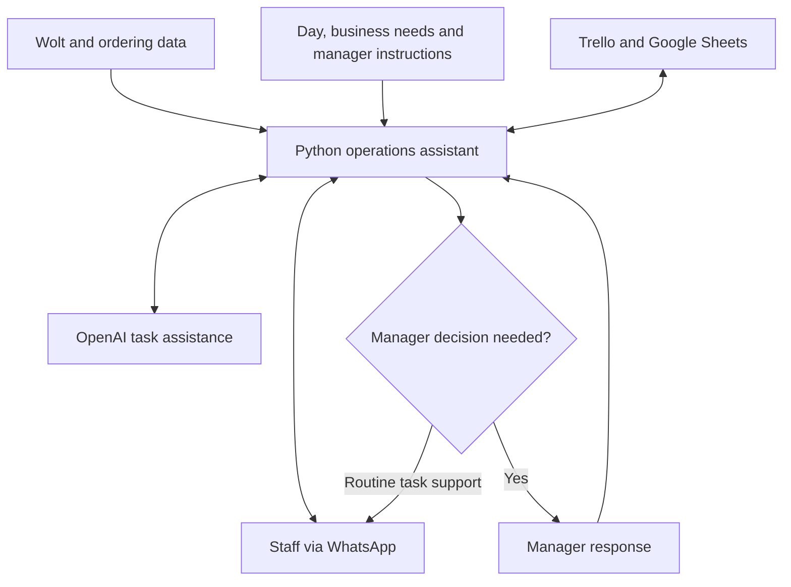

# Ariel's Pizza — AI Operations Assistant

**Python · API integration · Context-based task generation · Human-in-the-loop escalation**

**Project:** August 2024–May 2025, Odense, Denmark  
**Business framework:** Riimon Holdings  
**My role:** founder/operator and builder of the operations assistant  
**Scope:** a business operating across three locations  
**Status:** historical business implementation; the tool and concept transferred with the business sale in May 2025

[Back to my profile](../../README.md) · [Focused CV](../../career-portfolio/ai-implementation-cv.md)

## What I built and why it matters

I built a Python assistant that translated business activity and managers' priorities into practical staff tasks. It connected operational data, staff conversations and manager responses rather than providing a standalone question-and-answer interface.

This case demonstrates requirements discovery, API integration, workflow design and user adoption in a business I operated. It also demonstrates a human-in-the-loop (HITL) workflow: routine task support could run through the assistant, while uncertain or critical decisions were referred to a manager.

**Evidence scope:** the business, integrations and behaviours below are my account as the builder and operator, clarified in October 2026. The architecture below is a functional reconstruction. Historical source code, API configuration, execution logs and transfer records were not independently inspected for this public case.

## Workflows described

| Business need | Assistant behaviour | Human role |
|---|---|---|
| Prioritise work for the day | Generated tasks using the day, business performance and managers' instructions. | Managers supplied priorities and requirements; staff performed the tasks. |
| Purchasing and stock follow-up | Prepared supplier shopping lists and stock-check tasks, including after a busy day. | Staff checked goods and carried out purchasing work. |
| Cleaning and logistics | Created context-appropriate cleaning and other operational tasks. | Staff carried out the work. |
| Customer-service recovery | Prepared complaint follow-up tasks and context-appropriate compensation suggestions. | Managers handled decisions requiring human judgement. |
| Staff operational questions | Offered guidance for routine situations and sent a request for a manager response when a decision was ambiguous or critical. | A manager answered matters requiring human judgement. |
| Replacement-shift coordination | Received availability updates and asked other employees whether they wanted to cover an open shift. | Employees expressed whether they were available to cover the shift. |

## Integrations and functional architecture

- **Python:** application and workflow logic.
- **Wolt and the business ordering system:** API connections to operational information.
- **Trello and Google Sheets:** connected business tools.
- **WhatsApp:** staff interaction, task communication and manager-response requests.
- **OpenAI API:** AI-assisted task and guidance generation.

The diagram represents component relationships at a functional level. It does not specify payload fields, exact data routing, storage design or production permissions.

## Example of an operating cycle

1. Business information and manager instructions provide context for the day's work.
2. The assistant generates relevant tasks, such as a stock check, supplier list, cleaning activity or customer follow-up.
3. Staff ask operational questions through the assistant.
4. A matter requiring a critical or uncertain decision is sent to a manager for a response.
5. A shift-availability update can prompt a request to colleagues willing to cover the shift.

This sequence illustrates the reported behaviours; individual tasks could follow different paths.

## Controls described by the operator

Earlier project accounts describe application-secret handling, token limits and selection of models appropriate to the task. The current account adds manager escalation and context-based task generation.

The exact authentication, hosting and permission design remains outside the verified scope of this case. Azure is demonstrated separately in the Denmark in 5 project.

## Outcome and relevance to a team

- Developed the assistant for a business operating across **three locations**.
- Connected order information and manager priorities to staff workflows.
- Combined AI-assisted guidance with a route to human decisions.
- Transferred the tool and business concept with the business sale in **May 2025**.

The project shows how I connect business needs with implementation and adoption. Measured time savings, service-quality changes and financial returns are not available in this case.

## Public disclosure

This case excludes API credentials, account identifiers, employee and customer conversations, order-level data, absence reasons and live infrastructure details. Shift coordination is described in terms of availability. No source code from the transferred tool is published here.

**Evidence assessment: 3/5** for the reported implementation and business use: a detailed builder/operator account, without independent inspection of the historical technical or transaction records. This is an evidence score, not a hiring-success probability.

[See my current Azure implementation case](../denmark-in-5-azure/README.md) · [Contact Eric Ariel Rimón](mailto:eririmo@protonmail.com)
