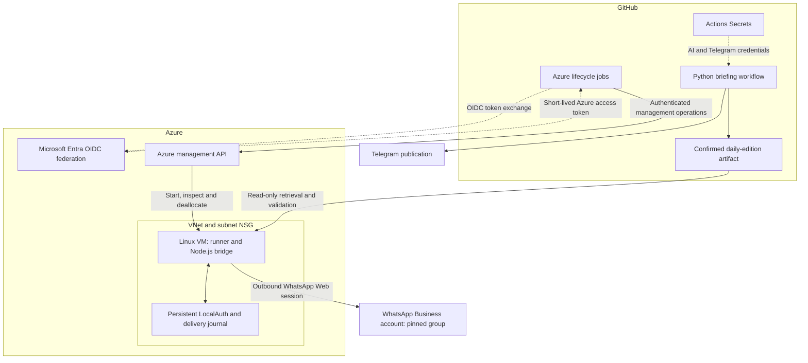

# Denmark in 5 — Azure Delivery Architecture

**AI implementation, Azure infrastructure and controlled delivery to WhatsApp Business**

I built the Azure delivery component for Denmark in 5, an AI-assisted Hebrew news briefing for Israelis in Denmark. The wider project combines Python, model APIs, editorial checks and Telegram publishing. This case study shows how I connected that workflow to a persistent delivery bridge on Azure, with separate handling of application secrets, cloud authentication and WhatsApp session state.

**Evidence:** Azure infrastructure deployment recorded on **12 September 2026**; source and execution records reviewed on **17 October 2026**. Current service availability is assessed separately.

[Engineering review](engineering-review.md) · [Implementation excerpts](implementation-excerpts.md) · [Deployment evidence](evidence/README.md) · [Back to my profile](../../README.md)

## The problem and my contribution

The WhatsApp delivery component needed a persistent browser session and delivery history. It also needed to use the already-confirmed edition, avoid duplicate sends, recover carefully from failures and limit unnecessary VM runtime.

My work spans the implementation and operation of that component:

- **Infrastructure:** Bicep definitions for an Ubuntu VM, virtual network, subnet, network security group and network interface.
- **Access and identity:** GitHub-to-Azure OIDC authentication, a dedicated resource-group scope in the bootstrap script, key-based SSH configuration and a system-assigned VM identity.
- **Delivery engineering:** a Node.js bridge on a self-hosted runner, artifact validation, a pinned destination and persistent delivery state.
- **Operational controls:** readiness checks, serialised delivery attempts, reconciliation after an uncertain send and a VM-deallocation cleanup path.

**Result demonstrated:** GitHub Actions recorded successful Azure authentication, deployment preview and VM/network deployment. The current source implements the delivery controls described here. These are separate evidence categories; a completed deployment does not establish uninterrupted message delivery.

## How the implemented architecture fits together

Arrows show logical data and control flow. The artifact is fetched by the bridge; it is not pushed through a public port on the VM. The VM has no public IP attached to its NIC. Its subnet permits outbound internet access.

**WhatsApp connection:** the dedicated WhatsApp Business account is linked through WhatsApp Web using Node.js, Chromium and `whatsapp-web.js`. The current transport is a browser-based integration, not Meta's official Business Platform Cloud API.

## Secrets are handled in separate places

| Material | Storage and consumer in the reviewed implementation |
|---|---|
| Model API keys and Telegram credentials | GitHub Actions Secrets, supplied to the Python workflow through environment variables. The reviewed bridge job does not receive these application credentials. |
| Azure deployment authentication | Entra federation exchanges a GitHub OIDC token for an Azure access token. Client, tenant and subscription identifiers are configuration; no Azure client password is used by the reviewed login flow. |
| GitHub artifact access | The bridge job receives the workflow's GitHub token with read permissions. |
| WhatsApp linked-device session | LocalAuth files on the Azure VM's persistent disk, outside the code checkout. Bootstrap and application code configure the authentication directory with mode 0700. |

This separation is visible in the source. Filesystem permissions are not a dedicated secrets vault, and the runner and bridge share a service account. The review does not establish Key Vault integration or application-level encryption of LocalAuth files.

## What I can bring to a team

This project demonstrates how I connect a business workflow to its operating environment: define the delivery boundary, implement infrastructure and integration code, manage authentication, make failures visible and document the next engineering decision.

It is relevant to **AI Implementation & Automation** work involving Python/API integration, Azure deployment, secure configuration and operational handover. I can walk through the implementation, explain its trade-offs and take responsibility for a defined component within a team.

[Review the engineering decisions and next steps](engineering-review.md) · [Contact Eric Ariel Rimón](mailto:eririmo@protonmail.com)
