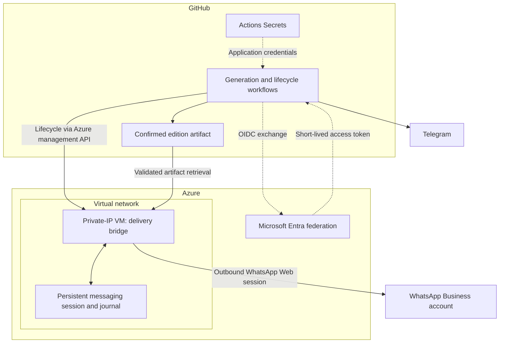

# Denmark in 5 — Azure Delivery Architecture

**AI implementation, API integration, Azure infrastructure and security controls**

Denmark in 5 turns Danish news and practical information into a Hebrew briefing for Israelis in Denmark. I develop the workflow through SundAI in collaboration with Living Denmark, connecting Python and model APIs with editorial checks and distribution.

This case study focuses on my Azure delivery component: infrastructure defined in Bicep, GitHub-to-Azure authentication, a persistent messaging bridge and controlled delivery of the confirmed edition.

**Evidence:** a successful infrastructure deployment was recorded in September 2026. Source and execution records were reviewed in October 2026. Historical deployment evidence and current service availability are separate claims.

[Engineering decisions](engineering-review.md) · [Selected implementation patterns](implementation-excerpts.md) · [Operating controls](operating-controls.md) · [Evidence](evidence/README.md) · [Public disclosure scope](public-disclosure.md) · [Back to my profile](../../README.md)

## The problem and my contribution

A scheduled briefing needs more than generated text. It needs to preserve the selected edition, reach the approved destination, avoid careless retries and leave a clear outcome for the operator.

- **Build the workflow:** connect source processing, model APIs, structured outputs and publication checks.
- **Define its infrastructure:** use Bicep for an Azure VM, virtual network, subnet and network security group.
- **Separate credential paths:** use Actions Secrets for application credentials, OIDC for Azure authentication and separate persistent messaging session state.
- **Control delivery:** validate the edition artifact, maintain a delivery journal and reconcile uncertain outcomes before retrying.
- **Operate responsibly:** add readiness checks, deployment validation, documentation and a VM-deallocation cleanup path.

## How the implemented architecture fits together

This is a logical view of the implemented components. Operational identifiers, exact permission bindings, host configuration and recovery procedures are deliberately excluded.

The bridge retrieves the confirmed artifact. The VM definition has no public IP associated with its network interface. This is not a claim that the entire environment is isolated or independently security-certified.

**Transport boundary:** the WhatsApp Business account connects through WhatsApp Web using `whatsapp-web.js`. This is a browser-based integration, not Meta's official Business Platform Cloud API.

## Separate handling of secrets and session state

| Material | Implemented approach |
|---|---|
| Model-provider and Telegram credentials | GitHub Actions Secrets, supplied to the workflow that needs them. |
| Azure deployment authentication | Entra OIDC federation; the reviewed login flow does not use a stored Azure client password. |
| Edition-artifact access | A GitHub job token with read permissions. |
| WhatsApp authentication state | Persistent session storage outside the code checkout, with filesystem access restrictions. |

These are distinct credential paths. They do not establish independent vault isolation or Azure Key Vault integration. Credential values, session files, recipient data and live configuration are excluded from this public case study.

## Operating effort and resource controls

My estimate of routine human input is **approximately one minute per edition**. This is an operator estimate, not a timed study or a claim about total maintenance effort.

A source review in October 2026 found model-output token limits, generation/review deadlines, bounded retry and draft-evaluation loops, artifact-retention settings and a VM-deallocation path. These are concrete implementation controls; they do not establish a measured cost saving or a subscription-wide spending ceiling.

Quality work includes source filters, publication checks and repeated draft evaluation. I describe this as **iterative quality refinement**; it is not a claim that the underlying model trains itself or that factual accuracy has been independently benchmarked.

[Read the control and measurement scope](operating-controls.md).

## Editorial assurance update — 19 October 2026

A subsequent application release reviewed 14 confirmed editions / 66 items and strengthened source context, enrichment, factual-completeness checks, reader relevance and diagnosis. The completion release passed **875 Python tests** and **23 reviewed editorial acceptance cases** in GitHub CI; 46 bridge tests passed locally. These are regression and implementation results, not measured editorial accuracy, engagement or live delivery.

[Read the editorial assurance case study and validation boundaries](editorial-assurance.md).

## Value for a team

I can translate an operational need into a Python/API workflow, connect it to Azure infrastructure, explain the relevant security controls and document its operating limits. My focus is **AI Implementation & Automation**: delivering a defined component, discussing trade-offs and handing over work that colleagues can understand.

The public evidence supports the implementation and historical deployment described here. It does not claim measured business savings, continuous availability or a completed enterprise security assessment.

[Explore the engineering decisions](engineering-review.md) · [Contact Eric Ariel Rimón](mailto:eririmo@protonmail.com)
