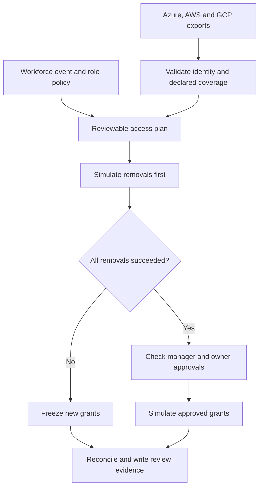

# Multi-Cloud Identity Governance

**A role change should remove old access, establish who approved the new access, and leave evidence someone can review.**

This project follows that change across Microsoft Entra ID, AWS IAM Identity Center and Google Cloud IAM. It connects workforce events, an entitlement catalogue, owner approvals and access-review evidence in one reproducible workflow.

[Successful role change](examples/output/mover/report.md) · [Failed-removal example](examples/output/failed-removal/report.md) · [Five-minute walkthrough](docs/interview-guide.md) · [Architecture](docs/architecture.md) · [CI](https://github.com/Popoo2020/Popoo2020/actions/workflows/multi-cloud-identity-governance.yml)

**Status:** working local implementation with synthetic data. Provider-export import and validation are implemented; cloud changes are simulated. No cloud credentials are needed to run it.

## The problem it demonstrates

At **Fjord Supply**, a fictional 180-person distributor, an operations analyst moves into finance. Entra groups control internal application access, AWS hosts order integrations, and Google Cloud hosts analytics. Adding the finance permissions is only half the job: the employee's old order-management access also needs to go.

The workflow answers three practical questions:

- Which existing assignments are still justified by the employee's role?
- Who approved each new assignment, and does that approval still match this plan?
- If one removal fails, what actually changed and what remains unresolved?

The bundled case removes three old assignments, preserves staff collaboration access and grants three finance assignments after manager and resource-owner approval. A second case injects an AWS removal failure: the other removals are retained, all three new grants are blocked, and the report records the unresolved access.

| Demonstration | Simulated removals | Simulated grants | Unresolved outcome |
|---|---:|---:|---|
| Approved move | 3 | 3 | Target assignments reached within the model |
| AWS removal fails | 2 | 0 | 1 failed removal; 3 grants blocked |
| Approvals missing | 3 | 0 | 3 grants blocked pending approval |

These are reproducible fixture results, not measured customer savings or production outcomes. [Business scenario and responsibilities](docs/scenario.md).

## Run the demonstration

Python **3.11 or newer** is required. The runtime uses only the Python standard library.

```bash
git clone https://github.com/Popoo2020/Popoo2020.git
cd Popoo2020/projects/multi-cloud-identity-governance
python -m identity_governance demo --output build/demo
python -m identity_governance verify --bundle build/demo/mover
python -m unittest discover -s tests -v
```

Open `build/demo/mover/report.md` and `build/demo/failed-removal/report.md`. The command also runs joiner, leaver, contractor-expiry, unapproved-change and access-review cases. Choose a new output directory for a later run; existing evidence is preserved.

Each case includes a plan, synthetic approvals, before/after state, operation outcomes, control findings, a JSONL audit chain and an unsigned checksum manifest. Verification checks the bundle's internal integrity; it does not authenticate the approvers or prove that cloud access changed.

## How the workflow connects



Planning is deterministic. An AI model does not decide who receives access. A plan is bound to the event, workforce record, policy and snapshot; changing them requires a new plan. Expired contracts, stale observations, unsupported export shapes and conflicting roles stop the relevant workflow. [Implementation decisions](docs/decisions.md).

## What each cloud adapter supports

| Provider | Implemented input | Fixture tests | Live collector | Live execution / tenant validation |
|---|---|---|---|---|
| Azure / Entra ID | Direct user-to-group membership from Graph-shaped exports | Yes | Not implemented | Not performed |
| AWS IAM Identity Center | Direct `USER` account assignments, one permission-set query at a time | Yes | Not implemented | Not performed |
| Google Cloud IAM | Unconditional allow-policy bindings to exact individual principals, including workforce identities | Yes | Not implemented | Not performed |

An [import bridge](identity_governance/imports.py) maps these exports to the same catalogue used by the planner. It checks identity bindings and declared query coverage, including empty AWS query results. It retains source pointers in a separate provenance file.

```bash
python -m identity_governance import-snapshot \
  --subject emp-014 --input examples/export-bundle.json \
  --captured-at 2026-11-26T08:55:00Z --output build/imported
python -m identity_governance plan --event mover \
  --snapshot build/imported/snapshot.json --output build/imported-plan.json
```

The date belongs to the fixed demonstration scenario. The importer validates internal consistency, not the truth of a collector's completeness assertion. Nested groups, AWS group assignments, GCP conditions and inherited/effective access require additional collectors and evaluation. They are not silently treated as supported. [Provider contracts and cloud deployment design](docs/provider-design.md).

## Identity governance evidence

Six project controls connect findings to evidence and reviewer actions: identity/scope, role reconciliation, approvals, separation of duties, departure/expiry and evidence handling. The [limited ISO 27001 and NIS2 cross-reference](docs/control-mapping.md) explains their relevance. This is assessment support, not an organizational certification or legal compliance determination.

The [deployment design](docs/provider-design.md#cloud-deployment-design--future-work) maps the same workflow to Azure, AWS and Google Cloud hosting services. It separates collectors, planners, approvers and future executors. No infrastructure is provisioned by this repository.

## Review the engineering

- [Tests](tests): lifecycle outcomes, stale and forged plans, approval replay, contract expiry, partial failure, provider boundaries and evidence modification.
- [Security model](SECURITY.md): trust boundaries and remaining operational controls.
- [Validation record](docs/validation.md): commands, checked outputs and the distinction between local tests and cloud validation.
- [Community benchmark](docs/portfolio-benchmark.md): lessons from Merill Fernando, Maester, Prowler and Cartography that informed the presentation and review criteria.
- [Contribution guide](CONTRIBUTING.md): reproduce a defect or add a provider case without introducing live credentials.

This extends my [Entra/IAM governance mini-lab](https://github.com/Popoo2020/Popoo2020/tree/main/entra-iam-governance-mini-lab). The focus here is the workforce lifecycle and evidence across clouds; the related [agent control plane](https://github.com/Popoo2020/Secure-Agent-Control-Plane) explores authorization for AI tools, and the [cloud compliance engine](https://github.com/Popoo2020/Cloud-Compliance-Engine-ISO27001) explores evidence reporting.

**Eric Ariel Rimón** · [GitHub portfolio](https://github.com/Popoo2020) · [SundAI](https://sundaibot.com)
