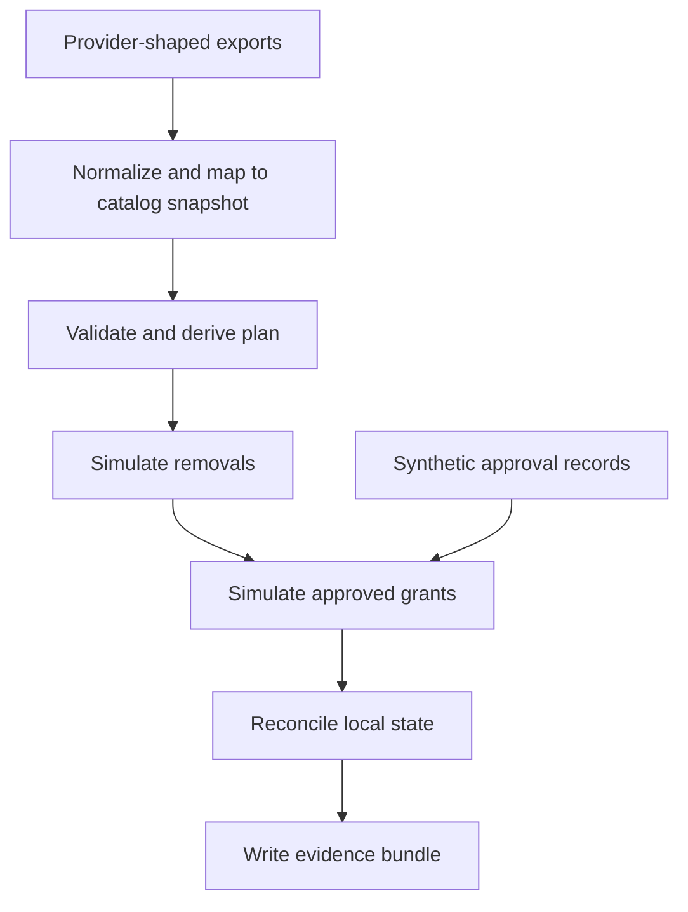

# Architecture

## The implemented boundary

The core runs locally on synthetic data or explicitly supplied export files. It does not contact a cloud API. Provider normalizers identify a supported subset of direct assignments; the catalog maps those records to governed entitlements and workforce identities. Unsupported or incomplete input must not become an empty, supposedly clean inventory.

The demo can also start directly from the snapshot in [scenario.json](../examples/scenario.json). Export import is a separate path, not proof that any data was collected from a real provider. See the [provider contract](provider-design.md) for rejected group, condition and inheritance cases.

[imports.py](../identity_governance/imports.py) checks declared coverage of the catalog's Azure tenant, GCP resource and every AWS account/permission-set query, including empty results. `import-snapshot` writes `snapshot.json` and `provenance.json`; `plan --snapshot` consumes the former. This bridge validates internal consistency, not actual collection completeness.

## Trust boundaries

**Sources to snapshot.** HR facts, the role catalog, owner identifiers and declared query coverage are supplied inputs. Explicit provider identifiers prevent casual matching by email. A collector must still establish authenticity, freshness, pagination and coverage. Local validation cannot prove an exporter told the truth.

**Snapshot to plan.** [engine.py](../identity_governance/engine.py) derives desired access from the workforce record and role policy. It validates scope and freshness, rejects conflicting target roles, and binds the plan to snapshot, policy and identity digests. The fixture allows snapshots up to 60 minutes old and plans lasting 30 minutes; these are configurable demonstration choices.

**Approval to execution.** Grants require distinct manager and resource-owner approvals for the relevant operation, subject and plan, within its validity window. Execution re-derives the authorized plan. Caller-supplied approver identifiers still do not constitute authentication, even when hashes and timestamps match. A future approval service needs its own identity and authorization controls.

## Ordering and failure

The simulator handles disablement where applicable, then removals, then grants. Any failed disablement or removal freezes all new grants. It can retain other successful removals and report a partial outcome. There is no distributed transaction or automatic restoration of obsolete rights.

After a partial failure, obtain a fresh, complete snapshot, reconcile what actually happened, derive a new plan and obtain approvals for its grants. Do not replay old approvals against changed state. The simulator's resulting state is not a newly collected cloud observation.

Reconciliation reports unexpected and missing catalogued assignments separately from operation status. `completed_simulation` means the planned local operations completed; it does not necessarily mean the target is fully reached, particularly for a review that intentionally makes no grants. Live access and session revocation remain unverified.

## Evidence and future hosting

Each bundle links the plan, approvals, before/after state, operation results, control assessments, audit events and readable report. The hash chain and manifest check local integrity; an actor who can rewrite the bundle can recompute them. Independent retention, signing and trusted timestamping are future controls.

The [deployment design](provider-design.md#cloud-deployment-design--future-work) describes Azure Functions/queues/table/blob, AWS Lambda/SQS/DynamoDB/S3, or Cloud Run/Pub/Sub/Firestore/Cloud Storage. These are hosting alternatives, not deployed infrastructure. Separate read, planning and execution identities; use workload identities, bounded retries and concurrency controls.

Authorization remains deterministic because reviewers must be able to reproduce the same decision from the same facts and policy. Additional checks can extend the policy and tests; an AI model is not part of the authorization path.
